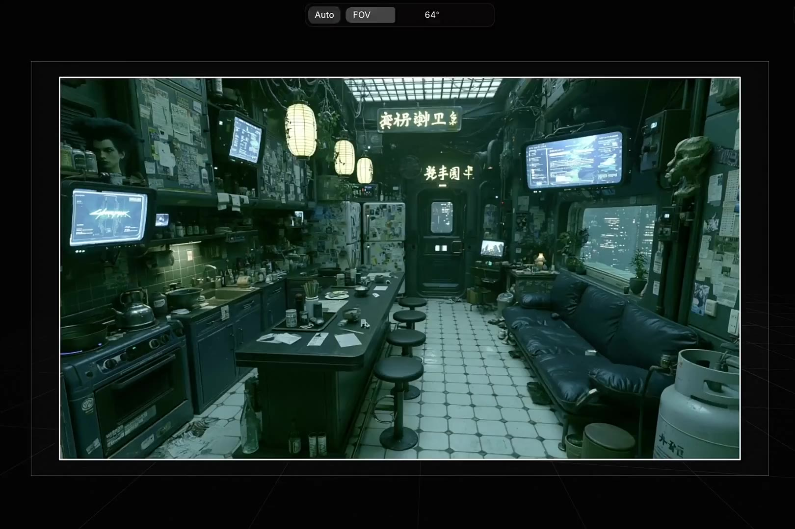
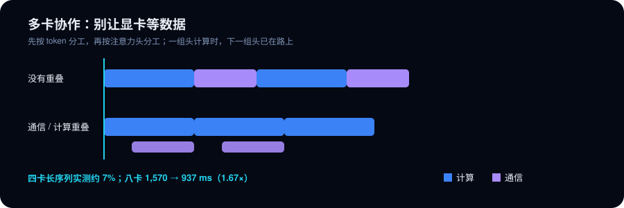
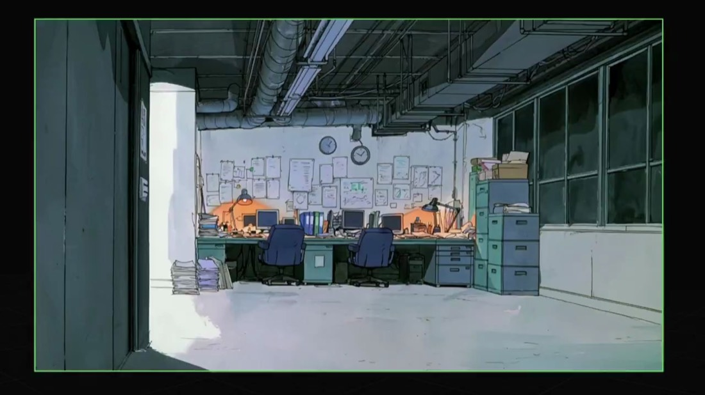

<p align="center"><b style="font-size:30px">TokenFly × AgentV</b></p>

<p align="center"><b>会自己变快的推理引擎。更省，更快，更真。</b></p>

<p align="center"><b>330 亿参数的视频模型 · 8 张消费级显卡 · 约 5 秒出片</b></p>

<p align="center">
  <a href="https://poping.art/agentv"></a>
  <a href="https://gapnil-ai.github.io/io/"></a>
  <a href="https://tokenfly.chat/"></a>
  
</p>

<p align="center"><a href="media/world.mp4"></a></p>

TokenFly 是推理引擎，AgentV 是用它拍电影的产品。

- **价格：拍得起。** 一条 5 秒视频的算力成本约 ¥0.02–0.03（估算），比托管 API 起步价低一到两个数量级。
- **速度：等得起。** 约 5 秒出片，720p 下生成 4.83 秒，短于 5.17 秒的成片时长。
- **空间真实感：镜头是真的。** 用对话搭出能走进去的 3D 空间，机位、焦距、路径都是真实的数值。

## TokenFly 引擎：约 5 秒出片，720p 下生成快于播放

TokenFly 是零隙智能从零自研的推理引擎，不依赖现成的推理框架，跑在 8 张没有 NVLink 的消费级 RTX 5090 上。同一个 330 亿参数的开源视频模型，单卡完整模式要将近 4 分钟；在 TokenFly 上，线上生成中位数 5.23 秒。

| 配置 | 交付一条 5.17 秒成片 | 相对起点 |
| --- | --- | --- |
| 1 卡 · 49 步完整模式 | 226.2 秒 | 1× |
| 4 卡 · 49 步 | 91.1 秒 | 2.5× |
| 4 卡 · 4 步 | 16 秒 | 14.1× |
| 8 卡 · 4 步 | 11.9 秒 | 19.0× |
| 7 卡 · 3 步（线上中位数） | 6.96 秒 | 32.5× |

<a href="https://gapnil-ai.github.io/io/#engine"></a>

- **少算**：压缩权重直接参与计算，只在重要区域精算（低精度 1.37×、稀疏注意力 2.62×、算子融合 1.19× / 1.14×）。
- **并行**：没有高端互连的消费级显卡照样多卡加速（文本编码 31.38 → 1.08 秒，单次前向 8 卡比 4 卡再快 1.67×）。
- **少等**：计算和传输同时进行，输出逐位一致（每次前向 −7.0%）。
- **少搬**：分块解码、硬件封装（分块解码 1.78×，封装 9.46 → 2.01 秒）。

同一组提示词端到端：TokenFly 9.19–11.73 秒，同为 3 步的 SGLang 29.65–31.74 秒（显卡数与精度不同），快约 3 倍；相比 20 步的标准 SGLang 部署（约 115 秒）快 10 倍以上。

### 消费级显卡，整机搬得进机房

- **数据不出内网**：整机直接进入客户机房，适合广告、影视、政务、医疗等合规敏感行业。
- **买得到，价格透明**：消费级显卡现货充足，不依赖受出口管制的数据中心 GPU；一台服务器硬件投入约 15–20 万元。
- **一台机器的产能**：按线上完整请求中位数 6.96 秒串行处理估算，单机日产约 1.2 万条。

## 自演进：零隙智能 × 奇点逃逸

这些提速不是人一项项调出来的。零隙智能与奇点逃逸共建了一套递归自我改进（RSI）系统：

1. **审定验收命题树**：先把“什么算改好了”拆成可逐条判定的条件，本轮内不变。
2. **提出并实现**：智能体依据剖析结果自主修改代码。
3. **独立评审**：数值对齐、画质不退化、输出完整、运行稳定，最后才看速度。
4. **存档与继承**：通过的代码和经验成为下一轮的起点，被退回的同样留档。
5. **人工关卡**：放在发布之前，不参与优化反馈。

> 智能体可以改代码，但不能改“什么算改好了”。

更快但不对的，一条都不留：快 7 倍的融合算子（音频相似度只有 0.859）、输出 148 帧的编译版解码器（应为 124 帧）、第二个请求就显存溢出的常驻方案、patch-FID 高达 31–48 的 8 步 LoRA，全部被退回。

只继承通过检验的代码，同时记住所有走不通的路：SVDQuant 只把误差从 17.6% 降到 16.8%、W8A8 带来 1.7 倍显存开销、通信分组 3/4 没有收益，这些结论留档后不再重试。

闭环还在跑：继续缩小低精度误差，8 卡拆成多组并行服务，接通首尾帧控制与参考图驱动，并把同一套闭环扩展到吞吐和成本目标。

<details><summary>原理动画</summary>




</details>

<details><summary>数据口径</summary>

TokenFly 实验记录与线上日志（2026 年 9–10 月），8×RTX 5090。1344×768 生成 5.23 秒（n=13），1280×720 生成 4.83 秒（n=152）。4 步与 3 步模式使用开源加速 LoRA，不声称与完整模式画质等价。¥0.02–0.03 单条成本为估算。
</details>

## AgentV：技术落到产品

AgentV 是跑在 TokenFly 上的导演台。引擎快了，才敢让你先搭出一个 3D 世界、摆好机位，再一个镜头一个镜头地拍。

### 别的工具在抽卡，AgentV 在拍片

| | 提示词直出视频 | AgentV |
| --- | --- | --- |
| 起点 | 一段提示词 | 一个用对话搭建的 3D 空间 |
| 运镜 | 用文字描述，结果靠运气 | 在空间里摆机位、调焦距、定路径 |
| 一致性 | 每次重新生成，容易跑偏 | 场景与角色资产全剧共用 |
| 修改 | 改一处，整条重新抽 | 改一句台词，只重做受影响的镜头 |
| 交付 | 一段段素材，自己拼接 | 自动排时间线，配音配乐，直接成片 |

### 三步，从一句话到电影级画面

<a href="https://poping.art/agentv"></a>

1. **对话模拟世界**：用自然语言描述场景，搭出一个可以走进去的 3D 空间。
2. **设计运镜**：摆机位、调焦距、定路径，白模里先定方向，满意了再出图。
3. **生成成片**：按镜头出画面，配音配乐，自动排进时间线。

### 一次设定，全剧不跑偏

<a href="https://poping.art/agentv"></a>

<a href="https://poping.art/agentv"></a>

## TokenFly Token 平台：同一台引擎，也开放给你的代码

不拍片也能用上它。[tokenfly.chat](https://tokenfly.chat/) 是从算子做起的 Token 平台：一个接口调用文本、图像、语音和视频模型，153 个模型、23 家厂商，价格低至厂商官方价的 2.6 折（2026 年 11 月 22 日官网所示，实时价格以官网为准）。

Claude Code 一行命令切换：

```bash
eval "$(curl -fsSL 'https://tokenfly.chat/switch/claude?model=glm-5.3')"
```

- **Token 平台**：按用量计费，随充随用，适合开发者和技术团队。
- **企业合同**：用承诺量换专属价格和额度。
- **私有化与推理优化**：部署到你的环境，或为你的模型和硬件做算子优化。

### More features

- Agent 跑完整条生产线：6 路并发、22 个模型择优、一处改动一处重做
- 活儿不会丢，人随时接手，命令在沙箱里运行
- 先预估，按实结；失败自动退款，预算到顶自动停
- 越用越省的 RSI 飞轮：每次运行都在喂养下一轮优化
- 私有化部署：素材与成片不出内网

## 场景

短剧与漫剧 · 影视预演 · 广告与电商 · 游戏与互动 · 合规敏感行业

## Website

https://gapnil-ai.github.io/io/
